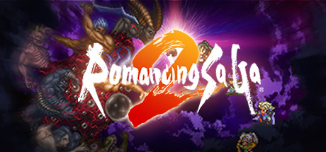

**Romancing SaGa 2 follows an empire across multiple generations of emperors facing the Seven Heroes over centuries. Features the Imperial dynasty mechanic where dying heroes pass stats to successors and a unique Formation research system tied to your battles.**

---

## 📖 About

Romancing SaGa 2 follows an empire across multiple generations of emperors facing the Seven Heroes over centuries. Features the Imperial dynasty mechanic where dying heroes pass stats to successors and a unique Formation research system tied to your battles.

## ⚠️ Problems Without Trainer

| Problem | Status |
|---------|--------|
| **Generation Gaps** — Understanding which skills transfer between emperor generations requires planning | ✅ Solved |
| **Formation Research** — Unlocking battle formations requires specifically winning battles in certain ways | ✅ Solved |
| **Seven Heroes Order** — Choosing which of the Seven to fight and when has major story implications | ✅ Solved |
| **Stat Inheritance** — Optimal inheritance planning requires understanding the stat carryover system | ✅ Solved |

## ✅ Solution

The **Romancing SaGa 2 Trainer** solves all these issues by giving you complete control over the game.

## 🎯 Full Feature List

- Unlimited Resources
- God Mode / Invincibility
- Instant Skill Cooldown
- One-Hit Kill
- Freeze Game Timer
- Unlock All Items & Achievements
- Custom Speed Multiplier
- Save State Anywhere

## 🚀 Quick Start

1. **Disable Windows Defender** temporarily (trainer may trigger false positive)
2. Download the trainer from the button above
3. Launch Romancing SaGa 2
4. Run the trainer as Administrator
5. Activate desired cheats with hotkeys

## 💎 Free vs Paid

| Feature | Free | Pro |
|---------|------|-----|
| Basic God Mode | ✅ | ✅ |
| Unlimited Resources | ✅ | ✅ |
| All Advanced Cheats | ❌ | ✅ |
| Auto-Updates | ❌ | ✅ |
| Priority Support | ❌ | ✅ |

## 💻 Requirements

- Windows 10/11 (64-bit)
- Romancing SaGa 2 (any version)
- .NET Framework 4.8+
- DirectX 11+

## 🍎 macOS

macOS users can use our alternative tool:

## ⚖️ Legal

This trainer is for educational and single-player use only. Use responsibly.

---

